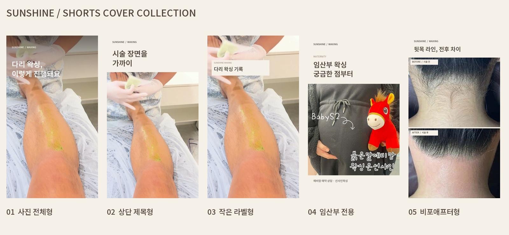

# 쇼츠 썸네일 · 5안

**기본 추천: 01 사진 전체형. 실제 전후 비교: 05.**

| 시안 | 완성 이미지 | 편집 원본 |
| --- | --- | --- |
| 01 사진 전체형 | [PNG](01.png) | [SVG](01.svg) |
| 02 상단 제목형 | [PNG](02.png) | [SVG](02.svg) |
| 03 작은 라벨형 | [PNG](03.png) | [SVG](03.svg) |
| 04 임산부 전용 | [PNG](04.png) | [SVG](04.svg) |
| 05 비포애프터형 | [PNG](05.png) | [SVG](05.svg) |

1080×1920. SVG는 사진·글자·도형이 분리되어 있습니다. Figma에 가져와 수정할 수 있으며, 기존 Figma 문서를 직접 수정한 결과는 아닙니다. [사진과 문구를 교체하는 방법](../../templates/shorts-covers-v1/README.md).

[사이트에서 확대·선택](https://sunshine-waxing-design-collection.alalshow3.chatgpt.site/#shorts-covers) · [영상 5종](../shorts/README.md)
